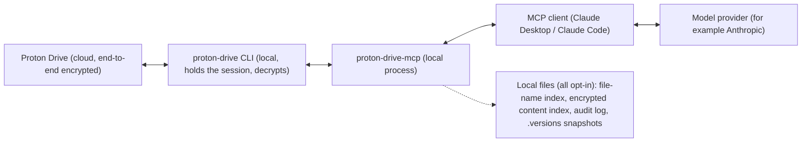

# Threat model

What `proton-drive-mcp` protects, what it trusts, and what it does not defend against. Written for people deciding whether to let an AI assistant work with an end-to-end encrypted Drive. For reporting a vulnerability see [SECURITY.md](SECURITY.md).

## What this is

A local MCP server (and companion CLI) that runs the official `proton-drive` CLI as a subprocess. It is an unofficial community project, not affiliated with or endorsed by Proton AG. It never sees your password or session token: the CLI holds the session.

## Data flow

- Everything left of the MCP client runs on your machine, except Proton's own servers, which only the official CLI talks to.
- **What reaches the model provider:** whatever a tool returns and your client sends on: file names, folder structure, and the text of any file you ask Claude to read (also OCR text of scans). Encryption protects the data at rest in the cloud and in transit; it does not protect what you choose to show the model.
- The server's own source contains no network code (no `http`, `https`, `net`, `fetch` or WebSocket use; checked by searching `src/` on 2026-11-02). There is no telemetry. Network traffic comes from the CLI, your MCP client and the model provider.

## Assets

| Asset | Where | Protection |
|---|---|---|
| Files and names on Drive | Proton, end-to-end encrypted | The CLI session; this project adds the guard layer below |
| Proton session | The official CLI's own storage | Not handled or read by this project |
| File-name index (`PROTON_DRIVE_INDEX=1`) | Private local folder, **plaintext** | Mode 0700 folder; off by default |
| Content index (`PROTON_DRIVE_CONTENT_INDEX=1`) | Local, AES-256-GCM | Key in the macOS keychain or Linux `secret-tool`, or from an environment variable; off by default |
| Audit log (`PROTON_DRIVE_AUDIT_LOG`) | Local file, hash-chained, mode 0600 | Queries and file content are not logged; off by default |

## Trust boundaries

1. **MCP client to server.** Anyone who can call the server's tools acts as the logged-in user. Run it only for clients you trust, on machines you trust.
2. **File content and names to the model.** Both are untrusted input. A file can contain text that tries to instruct the model (prompt injection). The tool descriptions tell the model to treat returned text as data, which reduces but does not remove the risk.
3. **Server to CLI.** The CLI is always started with an argument array (`spawn`, no shell), never through a command string.

## Controls (all opt-in, MCP server only)

| Variable | Effect |
|---|---|
| `PROTON_DRIVE_MODE=readonly` | Hides and refuses every tool that changes Drive or the account. Downloads to local disk stay available, but not with the `remove` strategies, which delete existing local files |
| `PROTON_DRIVE_REMOTE_ROOTS` | Confines every Drive path argument to the listed folders |
| `PROTON_DRIVE_AUDIT_LOG` | One tamper-evident JSON line per tool call, refusals included |
| `PROTON_DRIVE_SNAPSHOT_BEFORE_OVERWRITE=1` | Keeps the previous version before an overwrite |

Without them the server runs in full mode.

**Confirmation is not human approval.** Destructive and outward-facing tools take `confirmed: true`, but that is an argument the model fills in itself. Nothing ties it to a plan or to anything you said, and a model can send it on its first call. `drive_bulk_move` and `drive_bulk_trash` return a plan when called without it, but the call that applies is not checked against that plan. There is no plan token. What actually limits damage:

- `PROTON_DRIVE_MODE=readonly`: the changing tools are not offered and are refused if called.
- `PROTON_DRIVE_REMOTE_ROOTS`: the folders the model can reach on Drive.
- `PROTON_DRIVE_AUDIT_LOG`: a record of what happened, including refused calls. It does not prevent anything.
- Your MCP client's own tool-approval prompts. If you approve each tool call there, that is the human check.
- If the client supports MCP elicitation, the server asks you when a `confirmed` gate refuses a call and before it applies a bulk move or bulk trash. A model that sends `confirmed: true` to any other tool is not stopped by this.

Trash is reversible and the duplicate finder never deletes.

## Local file checks (on by default)

Tools that take a local path (`drive_upload`, `drive_download`, `drive_sync_plan`, `photos_upload`, `photos_download`) refuse credential and autostart locations such as `~/.ssh`, `~/.aws`, `~/.gnupg`, shell start-up files and `LaunchAgents`/`LaunchDaemons`, and secret-looking file names (`.env`, keys, certificates, `.netrc`, `.npmrc`, gcloud credential files). Matching follows symlinks and ignores letter case on macOS and Windows (tested on macOS and Linux; Windows behaviour is untested in CI).

- **Uploads:** a folder is checked entry by entry. It is refused if it holds a folder named `.ssh`, `.aws` or `.gnupg`, one of the listed credential files (also `.docker/config.json`, `.kube/config`, `.config/gcloud`), or a symlink that leads out of the folder. Other folders named `.docker`, `.kube` or `gcloud` are allowed. A folder with more than 200,000 entries is refused because it cannot be checked.
- **Downloads:** the item is checked under the name it will get inside the destination folder (folder plus remote name). The download is refused if that path is a protected location, equals or lies inside the audit log, its `.lock` or a `.versions` folder of the sync folder, or, for a folder item, would contain them. A remote path without an item name is refused. The destination folder itself may sit above these files, except when a whole drive root (`/my-files`, `/photos`, ...) is downloaded: the CLI writes that as `<folder>/root` (not under the name of the root), so `root` is checked and the folder must not hold the audit log, its `.lock` or a `.versions` folder.

Two settings change this. `PROTON_DRIVE_ALLOW_SENSITIVE_PATHS=1` turns the name and location checks off. `PROTON_DRIVE_LOCAL_ROOT` replaces them with an allowlist: local paths must sit inside the listed folders, and the deny list and the nested name checks no longer apply (a folder upload is then checked only for symlinks that leave it).

Limits that path checks cannot close: checks go by name, so a renamed copy of a credential folder (for example `aws/credentials`, `ssh-backup/authorized_keys` or `.ssh.` with a trailing dot) and a hardlink to a secret file under another name look ordinary; files can change between the check and the CLI's read; and the files inside a downloaded folder are written by the CLI and are not inspected one by one.

## Not covered

- **The companion CLI (`proton-drive-cli`)** is a tool you run yourself and is not restricted by the guard variables.
- **A compromised machine or client.** Whoever controls them controls the session.
- **Prompt injection that stays within the allowed tools.** Read-only mode and folder roots limit the damage; they cannot make a model ignore a malicious file.
- **Data you send to the model provider.** See your provider's privacy policy.
- **Changes in the official CLI.** This project is tested against CLI 0.8.0 and, for most operations, 0.9.0 (see the README).
- **No independent security audit** has been done. The code is open for review.

## Recommended setup for sensitive files

See "Secure deployment profile" in [SECURITY.md](SECURITY.md).
