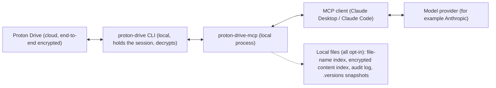

# Threat model

What `proton-drive-mcp` protects, what it trusts, and what it does not defend against. Written for people deciding whether to let an AI assistant work with an end-to-end encrypted Drive. For reporting a vulnerability see [SECURITY.md](SECURITY.md).

## What this is

A local MCP server (and companion CLI) that runs the official `proton-drive` CLI as a subprocess. It is an unofficial community project, not affiliated with or endorsed by Proton AG. It never sees your password or session token: the CLI holds the session.

## Data flow

- Everything left of the MCP client runs on your machine, except Proton's own servers, which only the official CLI talks to.
- **What reaches the model provider:** whatever a tool returns and your client sends on: file names, folder structure, and the text of any file you ask Claude to read (also OCR text of scans). Encryption protects the data at rest in the cloud and in transit; it does not protect what you choose to show the model.
- The server's own source contains no network code (no `http`, `https`, `net`, `fetch` or WebSocket use; checked by searching `src/` on 2026-11-02). There is no telemetry. Network traffic comes from the CLI, your MCP client and the model provider.

## Assets

| Asset | Where | Protection |
|---|---|---|
| Files and names on Drive | Proton, end-to-end encrypted | The CLI session; this project adds the guard layer below |
| Proton session | The official CLI's own storage | Not handled or read by this project |
| File-name index (`PROTON_DRIVE_INDEX=1`) | Private local folder, **plaintext** | Mode 0700 folder; off by default |
| Content index (`PROTON_DRIVE_CONTENT_INDEX=1`) | Local, AES-256-GCM | Key in the macOS keychain or Linux `secret-tool`, or from an environment variable; off by default |
| Audit log (`PROTON_DRIVE_AUDIT_LOG`) | Local file, hash-chained, mode 0600 | Queries and file content are not logged; off by default |

## Trust boundaries

1. **MCP client to server.** Anyone who can call the server's tools acts as the logged-in user. Run it only for clients you trust, on machines you trust.
2. **File content and names to the model.** Both are untrusted input. A file can contain text that tries to instruct the model (prompt injection). The tool descriptions tell the model to treat returned text as data, which reduces but does not remove the risk.
3. **Server to CLI.** The CLI is always started with an argument array (`spawn`, no shell), never through a command string.

## Controls (all opt-in, MCP server only)

| Variable | Effect |
|---|---|
| `PROTON_DRIVE_MODE=readonly` | Hides and refuses every tool that changes Drive or the account |
| `PROTON_DRIVE_REMOTE_ROOTS` | Confines every Drive path argument to the listed folders |
| `PROTON_DRIVE_AUDIT_LOG` | One tamper-evident JSON line per tool call, refusals included |
| `PROTON_DRIVE_SNAPSHOT_BEFORE_OVERWRITE=1` | Keeps the previous version before an overwrite |

Without them the server runs in full mode. Bulk move and bulk trash are two steps (plan, then apply), trash is reversible, and the duplicate finder never deletes.

## Not covered

- **The companion CLI (`proton-drive-cli`)** is a tool you run yourself and is not restricted by the guard variables.
- **A compromised machine or client.** Whoever controls them controls the session.
- **Prompt injection that stays within the allowed tools.** Read-only mode and folder roots limit the damage; they cannot make a model ignore a malicious file.
- **Data you send to the model provider.** See your provider's privacy policy.
- **Changes in the official CLI.** This project is tested against CLI 0.8.0 only (see the README).
- **No independent security audit** has been done. The code is open for review.

## Recommended setup for sensitive files

See "Secure deployment profile" in [SECURITY.md](SECURITY.md).
