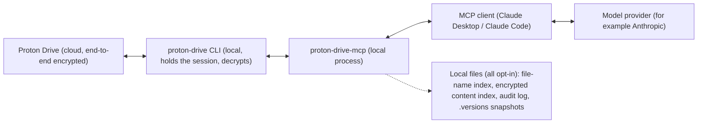

# Threat model

What `proton-drive-mcp` protects, what it trusts, and what it does not defend against. Written for people deciding whether to let an AI assistant work with an end-to-end encrypted Drive. For reporting a vulnerability see [SECURITY.md](SECURITY.md).

## What this is

A local MCP server (and companion CLI) that runs the official `proton-drive` CLI as a subprocess. It is an unofficial community project, not affiliated with or endorsed by Proton AG. It never sees your password or session token: the CLI holds the session.

## Data flow

- Everything left of the MCP client runs on your machine, except Proton's own servers, which only the official CLI talks to.
- **What reaches the model provider:** whatever a tool returns and your client sends on: file names, folder structure, and the text of any file you ask Claude to read (also OCR text of scans). Encryption protects the data at rest in the cloud and in transit; it does not protect what you choose to show the model.
- The server's own source contains no network code (no `http`, `https`, `net`, `fetch` or WebSocket use; checked by searching `src/` on 2026-11-02). There is no telemetry. Network traffic comes from the CLI, your MCP client and the model provider.

## Assets

| Asset | Where | Protection |
|---|---|---|
| Files and names on Drive | Proton, end-to-end encrypted | The CLI session; this project adds the guard layer below |
| Proton session | The official CLI's own storage | Not handled or read by this project |
| File-name index (`PROTON_DRIVE_INDEX=1`) | Private local folder, **plaintext** | Mode 0700 folder; off by default |
| Content index (`PROTON_DRIVE_CONTENT_INDEX=1`) | Local, AES-256-GCM | Key in the macOS keychain or Linux `secret-tool`, or from an environment variable; off by default |
| Audit log (`PROTON_DRIVE_AUDIT_LOG`) | Local file, hash-chained, mode 0600 | Queries and file content are not logged; off by default |

## Trust boundaries

1. **MCP client to server.** Anyone who can call the server's tools acts as the logged-in user. Run it only for clients you trust, on machines you trust.
2. **File content and names to the model.** Both are untrusted input. A file can contain text that tries to instruct the model (prompt injection). The tool descriptions tell the model to treat returned text as data, which reduces but does not remove the risk.
3. **Server to CLI.** The CLI is always started with an argument array (`spawn`, no shell), never through a command string.

## Controls (MCP server only; the approval gate is on by default, the rest are opt-in)

| Variable | Effect |
|---|---|
| `PROTON_DRIVE_APPROVAL=human\|strict\|model` | Who approves destructive and outward-facing operations. Default `human`: a person, never the model. `strict` gates every changing tool; `model` restores the old behaviour |
| `PROTON_DRIVE_MODE=readonly` | Hides and refuses every tool that changes Drive or the account. Downloads to local disk stay available, but not with the `remove` strategies, which delete existing local files |
| `PROTON_DRIVE_REMOTE_ROOTS` | Confines every Drive path argument to the listed folders |
| `PROTON_DRIVE_AUDIT_LOG` | One tamper-evident JSON line per tool call, refusals included |
| `PROTON_DRIVE_SNAPSHOT_BEFORE_OVERWRITE=1` | Keeps the previous version before an overwrite |

Without the opt-in ones the server runs in full mode, with the approval gate in `human` mode.

## Human approval gate (on by default since 1.11.0)

Before 1.11.0, destructive tools took `confirmed: true`, an argument the model fills in itself. That was not human approval. It is now not an authorisation at all (the argument is still accepted, deprecated, and ignored in the default mode; it remains only the plan/apply switch of `drive_bulk_move` and `drive_bulk_trash`).

**What the gate guarantees.** In the default mode (`PROTON_DRIVE_APPROVAL` unset or `human`), a gated operation runs only after a person said yes to that exact operation. The operation is built from the server's validated arguments; the same object is shown, hashed and executed. The text the person sees is written by the server: a fixed first line per tool, then one line per validated value, with control, bidirectional, zero-width and every other Unicode format or default-ignorable character in names shown as `\uXXXX` so a file name cannot add or reorder lines or hide in blank space. Fields a person must recognise (invitee and inviter e-mail, the item named by a `uid`) list every non-ASCII character by code point (`contains non-ASCII: U+0430`), so a Cyrillic look-alike letter is visible. Operations addressed only by a `uid` (`drive_delete`, invitations) show the name, inviter and folder looked up from Drive before the question, or `(name not resolved)`. Passwords and message texts are never shown. A refused call changes nothing and is written to the audit log with a code (`approval_required`, `approval_declined`, `approval_unavailable`, `approval_changed`); an approved call records the channel and a short hash of the operation.

**The two channels.**
1. *Elicitation in the same call.* If the client declares MCP elicitation (form mode), the server asks for every gated call, whatever `confirmed` says. Only Accept with the approve box ticked counts. An explicit decline is final. One dialog is open at a time; a second gated call meanwhile is refused (`approval_unavailable`), not queued, so a looping model cannot stack dialogs. A cancel, an error or a 120 s timeout is not a no: the server then falls back to channel 2 for that operation (a pending record and an `approval_required` refusal with the terminal command), which still needs a person at a terminal; with no usable store it is a plain refusal. After 5 declined or failed prompts in a minute the server stops asking and refuses. For the two bulk tools the plan is computed again after the approval, and nothing is applied if it differs from the plan that was approved.
2. *Terminal approval, for clients that cannot elicit.* The server refuses with a code and stores a record of the operation (tool, hash of the operation, the text above) in a private approvals folder. The person runs `proton-drive-cli approve <code>` in an interactive terminal, reads the stored text, and types `yes`. The next identical call consumes the approval once. A request lasts 10 minutes, an approval 5; a different argument is a different operation; a second use or a concurrent second call is refused (the record is claimed by an atomic rename). The model never receives a secret: the code is an identifier, and the person reads the server's record, not the model's description. The command must see the same approvals folder as the server (same `PROTON_DRIVE_APPROVAL_DIR`, `XDG_CACHE_HOME` and `HOME`). The approvals folder is outside the sync folder (startup check) and out of reach of the download tools.

If neither channel exists, the call is refused.

**What it trusts.**
- The client's dialog: the gate cannot tell a person from a client that answers the dialog itself or forwards it to the model.
- Your own account and files: anything that can write your files or the approvals folder can forge an approval.
- That you read what you approve.
- POSIX rename semantics on a local disk for the terminal route (macOS and Linux; Windows is untested, and a network-mounted approvals folder is not assumed to work).

**What it does not cover.**
- A compromised local machine, or any process that can write your files.
- A malicious or naive MCP client, and an auto-answer you configure yourself (for example a Claude Code `Elicitation` hook or an Agent SDK handler). That is you switching the gate off.
- **A model with a shell.** If the client gives the model a terminal (Claude Code's Bash tool, Desktop Commander and similar), it can run the official `proton-drive` CLI directly, outside this server. Nothing here can stop that. Deny it in the client; the README has an example rule for Claude Code. That rule is a pattern match, not a complete barrier.
- Copying files into a folder under `/my-files` that is already shared or has a public link: the destination's sharing state is not checked. `PROTON_DRIVE_REMOTE_ROOTS` limits where the model can write.
- What a person approves without reading. Short, fixed-format prompts help; they do not make the decision.
- Whether a given client shows the dialog at all. Claude Code in a terminal does. For Claude Desktop this is not verified; a client that cannot elicit gets the terminal route. A client that declares elicitation but auto-cancels or errors gets the terminal route for each gated call (it fails closed: still a person at a terminal). A client that auto-declines explicitly makes gated tools unusable there; use `model` knowingly.

**What is not gated in the default mode.** Reversible changes inside your own `/my-files`: a single `drive_trash`, `drive_restore`, `drive_move` / `drive_rename` / `drive_copy` / `drive_mkdir` inside `/my-files`, an upload that replaces nothing, album create / update / add, `photos_upload`, and `drive_write_file` to a new file. Paths under `/shared-with-me` are gated for all of these, and so is `drive_invitation_accept`. `drive_restore` by `uid` alone is not gated either (reversible, accepted risk; `strict` covers it, and shows the item's path when it can look it up). A loop of single `drive_trash` calls is not stopped in the default mode; trash is recoverable for a limited time (the retention period is not verified here).

**`strict`** (`PROTON_DRIVE_APPROVAL=strict`) puts every tool that changes Drive or the account behind the gate, including the ungated set above. Use it with sensitive data. An unknown value of the variable is treated as `strict`.

**`model`** (`PROTON_DRIVE_APPROVAL=model`) is an opt-out that restores the 1.10.1 behaviour: the assistant's own `confirmed: true` is enough, and an eliciting client is asked only when a call would otherwise be refused. Nobody approves in this mode; the server prints a warning at startup. It exists for unattended jobs where no person is present. Combine it with `PROTON_DRIVE_REMOTE_ROOTS` and the audit log.

The other controls still apply, and are checked before any approval is asked:

- `PROTON_DRIVE_MODE=readonly`: the changing tools are not offered and are refused if called.
- `PROTON_DRIVE_REMOTE_ROOTS`: the folders the model can reach on Drive.
- `PROTON_DRIVE_AUDIT_LOG`: a record of what happened, including refused calls. It does not prevent anything.
- Your MCP client's own tool-approval prompts, if you use them, are a second check.

Trash is reversible and the duplicate finder never deletes.

## Local file checks (on by default)

Tools that take a local path (`drive_upload`, `drive_download`, `drive_sync_plan`, `photos_upload`, `photos_download`) refuse credential and autostart locations such as `~/.ssh`, `~/.aws`, `~/.gnupg`, shell start-up files and `LaunchAgents`/`LaunchDaemons`, and secret-looking file names (`.env`, keys, certificates, `.netrc`, `.npmrc`, gcloud credential files). Matching follows symlinks and ignores letter case on macOS and Windows (tested on macOS and Linux; Windows behaviour is untested in CI).

- **Uploads:** a folder is checked entry by entry. It is refused if it holds a folder named `.ssh`, `.aws` or `.gnupg`, one of the listed credential files (also `.docker/config.json`, `.kube/config`, `.config/gcloud`), or a symlink that leads out of the folder. Other folders named `.docker`, `.kube` or `gcloud` are allowed. A folder with more than 200,000 entries is refused because it cannot be checked.
- **Downloads:** the item is checked under the name it will get inside the destination folder (folder plus remote name). The download is refused if that path is a protected location, equals or lies inside the audit log, its `.lock` or a `.versions` folder of the sync folder, or, for a folder item, would contain them. A remote path without an item name is refused. The destination folder itself may sit above these files, except when a whole drive root (`/my-files`, `/photos`, ...) is downloaded: the CLI writes that as `<folder>/root` (not under the name of the root), so `root` is checked and the folder must not hold the audit log, its `.lock` or a `.versions` folder.

Two settings change this. `PROTON_DRIVE_ALLOW_SENSITIVE_PATHS=1` turns the name and location checks off. `PROTON_DRIVE_LOCAL_ROOT` replaces them with an allowlist: local paths must sit inside the listed folders, and the deny list and the nested name checks no longer apply (a folder upload is then checked only for symlinks that leave it).

Limits that path checks cannot close: checks go by name, so a renamed copy of a credential folder (for example `aws/credentials`, `ssh-backup/authorized_keys` or `.ssh.` with a trailing dot) and a hardlink to a secret file under another name look ordinary; files can change between the check and the CLI's read; and the files inside a downloaded folder are written by the CLI and are not inspected one by one.

## Not covered

- **The companion CLI (`proton-drive-cli`)** is a tool you run yourself and is not restricted by the guard variables.
- **A compromised machine or client.** Whoever controls them controls the session.
- **Prompt injection that stays within the allowed tools.** Read-only mode and folder roots limit the damage; they cannot make a model ignore a malicious file.
- **Data you send to the model provider.** See your provider's privacy policy.
- **Changes in the official CLI.** This project is tested against CLI 0.8.0 and, for most operations, 0.9.0 (see the README).
- **No independent security audit** has been done. The code is open for review.

## Recommended setup for sensitive files

See "Secure deployment profile" in [SECURITY.md](SECURITY.md).
